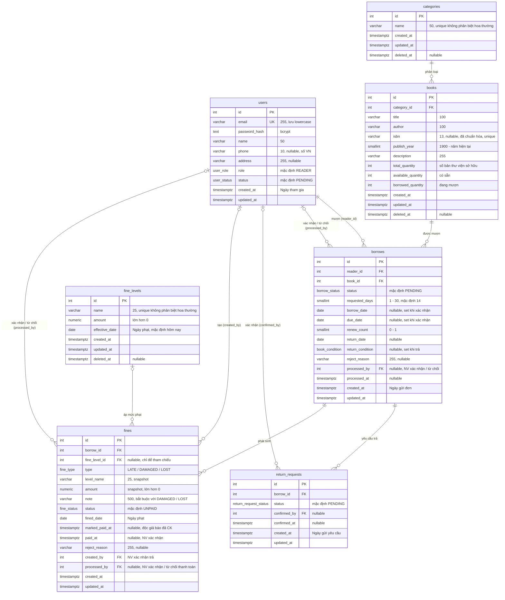

# ERD — Hệ Thống Quản Lý Thư Viện

Stage 2 (Design). Nguồn cho schema Supabase (PostgreSQL) và `prisma/schema.prisma`. Thiết kế bám theo các flow trong [`flows/`](flows/README.md) và các giả định A1–A17 ở đó.

**Quy ước:**
- Tên bảng / cột: `snake_case`, tiếng Anh, số nhiều cho bảng. Prisma model dùng `PascalCase` + `@@map` / `@map`.
- Khóa chính: `id integer GENERATED ALWAYS AS IDENTITY`. Dùng số để mã phiếu phạt ngắn, dễ ghi vào nội dung chuyển khoản (vd. `PP000123`).
- Thời điểm: `timestamptz` (lưu UTC). Ngày nghiệp vụ (`borrow_date`, `due_date`, `return_date`, `fined_date`): `date`, tính theo múi giờ `Asia/Ho_Chi_Minh` ở backend.
- Tiền: `numeric(12,0)` (VND, không có phần lẻ).
- Xóa mềm (A11): `categories`, `books`, `fine_levels` có `deleted_at`. Các ràng buộc unique chỉ áp dụng cho bản ghi chưa xóa.
- Trạng thái lưu bằng Postgres enum, giá trị tiếng Anh; FE hiển thị nhãn tiếng Việt (xem [Enum](#enum)).

## Sơ đồ

## Enum

| Enum | Giá trị | Nhãn hiển thị | Dùng ở |
|------|---------|---------------|--------|
| `user_role` | `READER` · `LIBRARIAN` · `ADMIN` | Độc giả · Nhân viên thư viện · Quản lý viên | 2.6.2 |
| `user_status` | `PENDING` · `ACTIVE` · `DISABLED` | Chờ xác nhận · Kích hoạt · Vô hiệu hóa | 2.1.1, 2.6.1 |
| `borrow_status` | `PENDING` · `BORROWING` · `OVERDUE` · `RETURNED` · `REJECTED` | Chờ xác nhận · Đang mượn · Quá hạn · Đã trả · Bị từ chối | 2.3.x, 2.4.2 |
| `return_request_status` | `PENDING` · `CONFIRMED` | Chờ xác nhận · Đã xác nhận | 2.4.1, 2.4.2 |
| `book_condition` | `NORMAL` · `DAMAGED` · `LOST` | Bình thường · Hư hỏng · Mất | 2.4.2 |
| `fine_type` | `LATE` · `DAMAGED` · `LOST` | Trả muộn · Hư hỏng · Mất | 2.4.2, 2.5.2 |
| `fine_status` | `UNPAID` · `PENDING` · `PAID` · `REJECTED` | Chưa thanh toán · Chờ xác nhận · Đã thanh toán · Từ chối | 2.5.2, 2.5.3 |

## Ràng buộc ở DB

Đây là lớp bảo vệ cuối; backend vẫn kiểm tra và trả lỗi thân thiện trước (xem flow).

### `users`
- `UNIQUE (email)` — email luôn được trim + lowercase trước khi lưu (2.1.1), nên unique thường là đủ và bắt được đăng ký trùng đồng thời.
- `CHECK (phone IS NULL OR phone ~ '^0[0-9]{9}$')` (A13).
- `phone`, `address` nullable vì đăng ký chỉ nhập Email, Tên, Mật khẩu; 2.1.3 bắt buộc `address` khi cập nhật (Joi).

### `categories`
- `UNIQUE INDEX ON categories (lower(name)) WHERE deleted_at IS NULL` (A12).

### `books`
- `FK category_id → categories(id) ON DELETE RESTRICT`. Thể loại chỉ xóa mềm; guard "còn sách chưa xóa" kiểm tra ở backend (2.2.1).
- `UNIQUE INDEX ON books (isbn) WHERE isbn IS NOT NULL AND deleted_at IS NULL` (A12).
- `CHECK (isbn IS NULL OR length(isbn) IN (10, 13))` — checksum kiểm tra ở Joi.
- `CHECK (publish_year >= 1900)` — cận trên "năm hiện tại" kiểm tra ở Joi (CHECK không được dùng hàm thay đổi theo thời gian).
- `CHECK (available_quantity >= 0 AND borrowed_quantity >= 0)`.
- `CHECK (total_quantity = available_quantity + borrowed_quantity)` — bất biến tồn kho trong [README](flows/README.md). `total_quantity > 0` chỉ bắt buộc khi tạo (Joi); sau khi mất / hư có thể về 0 (A10).
- Không lưu trạng thái "Có sẵn / Hết sách": suy ra từ `available_quantity > 0`.

### `borrows`
- `FK reader_id → users(id)`, `FK book_id → books(id)`, `FK processed_by → users(id)`, đều `ON DELETE RESTRICT` (user và sách không bị xóa cứng).
- `CHECK (requested_days BETWEEN 1 AND 30)`, `CHECK (renew_count BETWEEN 0 AND 1)`.
- `UNIQUE INDEX ON borrows (reader_id, book_id) WHERE status IN ('PENDING','BORROWING','OVERDUE')` — một độc giả không có hai đơn hoạt động cho cùng sách (A6).
- `CHECK (status <> 'REJECTED' OR reject_reason IS NOT NULL)`.
- `CHECK (status NOT IN ('BORROWING','OVERDUE','RETURNED') OR (borrow_date IS NOT NULL AND due_date IS NOT NULL))`.
- `CHECK (status <> 'RETURNED' OR (return_date IS NOT NULL AND return_condition IS NOT NULL))`.
- Giới hạn 5 đơn hoạt động và "không có phạt chưa thanh toán" kiểm tra ở backend trong transaction (cần đếm nhiều dòng, không biểu diễn được bằng CHECK).

### `return_requests`
- `FK borrow_id → borrows(id) ON DELETE CASCADE`, `FK confirmed_by → users(id)`.
- `UNIQUE INDEX ON return_requests (borrow_id) WHERE status = 'PENDING'` — chỉ một yêu cầu chờ trên mỗi đơn (2.4.1).
- `CHECK (status <> 'CONFIRMED' OR (confirmed_by IS NOT NULL AND confirmed_at IS NOT NULL))`.

### `fine_levels`
- `UNIQUE INDEX ON fine_levels (lower(name)) WHERE deleted_at IS NULL` (A12).
- `CHECK (amount > 0)`.

### `fines`
- `FK borrow_id → borrows(id) ON DELETE RESTRICT`, `FK fine_level_id → fine_levels(id) ON DELETE SET NULL`, `FK created_by / processed_by → users(id)`.
- `level_name`, `amount` là **snapshot** lúc tạo phiếu: sửa hoặc xóa mềm mức phạt không ảnh hưởng phiếu cũ (2.5.1, A11).
- `UNIQUE (borrow_id, type)` — mỗi đơn tối đa một phiếu Trả muộn và một phiếu Hư hỏng / Mất.
- `CHECK (amount > 0)`.
- `CHECK (type = 'LATE' OR note IS NOT NULL)` — ghi chú bắt buộc với Hư hỏng / Mất (2.4.2).
- `CHECK (status <> 'PAID' OR (paid_at IS NOT NULL AND processed_by IS NOT NULL))`.
- `CHECK (status <> 'REJECTED' OR reject_reason IS NOT NULL)`.
- Độc giả của phiếu lấy qua `borrows.reader_id` (không lưu trùng để tránh lệch dữ liệu).

## Index truy vấn

| Index | Phục vụ |
|-------|---------|
| `books (category_id) WHERE deleted_at IS NULL` | Lọc thể loại 2.2.3, guard xóa thể loại 2.2.1 |
| `books (lower(title))`, `books (lower(author))` | Sắp xếp / tìm kiếm 2.2.3. Nếu cần tìm `ILIKE '%q%'` nhanh khi dữ liệu lớn: GIN `pg_trgm` |
| `borrows (reader_id, status)` | Lịch sử mượn 2.3.3, đếm đơn hoạt động 2.3.1 |
| `borrows (book_id, status)` | Guard xóa sách 2.2.5, lịch sử mượn của sách 2.2.4, sắp xếp "Phổ biến" |
| `borrows (status, due_date)` | Job cập nhật Quá hạn, dashboard độc giả quá hạn 2.7.1 |
| `borrows (created_at)` | "Đơn mượn hôm nay", báo cáo mượn trả theo kỳ 2.7.x |
| `return_requests (status, created_at)` | Tab "Chờ xác nhận trả" 2.4.2 |
| `fines (borrow_id)` | Kiểm tra phạt chưa thanh toán khi mượn 2.3.1 |
| `fines (status, created_at)` | Danh sách phiếu cho NV 2.5.3 |
| `fines (paid_at) WHERE status = 'PAID'` | Doanh thu phạt 2.7.2 |

## Ánh xạ số liệu ↔ cột

| Số liệu | Cách tính |
|---------|-----------|
| Số lần mượn (hồ sơ 2.1.3), Lượt mượn (sort 2.2.3), Top 5 sách (2.7.1) | `COUNT(borrows) WHERE borrow_date IS NOT NULL` (đơn đã được xác nhận) |
| Tổng tiền phạt (hồ sơ, A14) | `SUM(fines.amount) WHERE status <> 'PAID'` của các đơn thuộc độc giả |
| Sách Có sẵn / Đang mượn (2.7.1) | `SUM(available_quantity)` / `SUM(borrowed_quantity)` trên sách chưa xóa |
| Sách Bị mất / Hư hỏng (2.7.1, báo cáo Sách mất - hư 2.7.2) | `COUNT(borrows) WHERE return_condition = 'LOST' / 'DAMAGED'` |
| Độc giả nợ quá hạn | `borrows` có `status IN ('BORROWING','OVERDUE') AND due_date < hôm nay`, nhóm theo `reader_id` |

## Bảo mật Supabase

Backend kết nối trực tiếp Postgres qua Prisma (không dùng Supabase Auth / PostgREST). Bật **RLS trên mọi bảng và không tạo policy nào** để role `anon` / `authenticated` của API công khai Supabase không đọc / ghi được dữ liệu (nhất là `users.password_hash`). Prisma dùng role `postgres` nên không bị RLS chặn.

## Ảnh hưởng của các câu hỏi mở

Các câu hỏi ở [README](flows/README.md#câu-hỏi-mở-prd-chưa-đề-cập-flow-chưa-vẽ) chưa chốt; ERD hiện **không** hỗ trợ chúng. Nếu chốt "có":

| # | Câu hỏi | Thay đổi schema |
|---|---------|-----------------|
| 1 | NV từ chối yêu cầu trả | Thêm `REJECTED` vào `return_request_status` + cột `reject_reason` |
| 2 | Độc giả hủy đơn mượn / yêu cầu trả | Thêm `CANCELLED` vào `borrow_status` và `return_request_status` |
| 3 | Ảnh biên lai chuyển khoản | Cột `fines.receipt_url` (Supabase Storage) |
| 4 | NV xác nhận tiền mặt tại quầy | Không đổi schema; cho phép `UNPAID → PAID` ở backend |
| 5 | Email thông báo | Có thể thêm bảng `notifications` nếu cần lưu lịch sử |

Giới hạn 5 sách / 14 ngày / 30 ngày / +7 ngày đang là hằng số trong code. Nếu sau này Admin cần chỉnh ("cài đặt hệ thống"), thêm bảng `settings (key PK, value)`.
