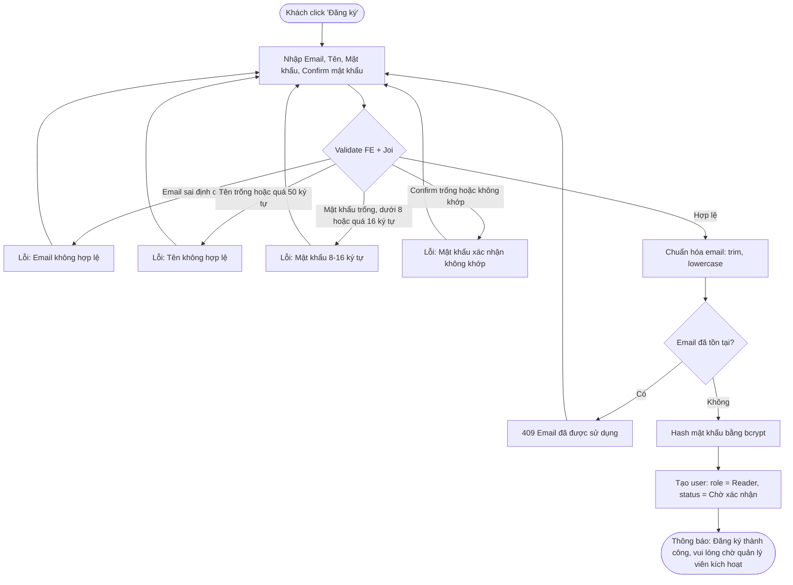
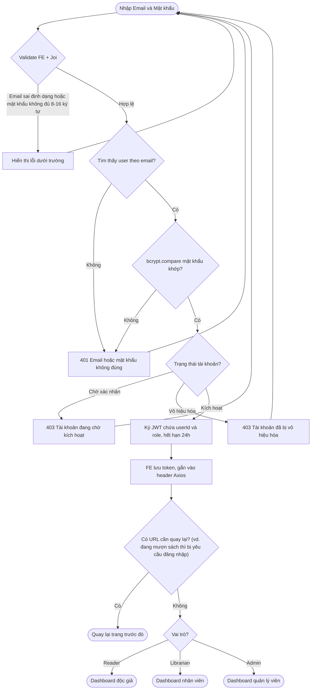
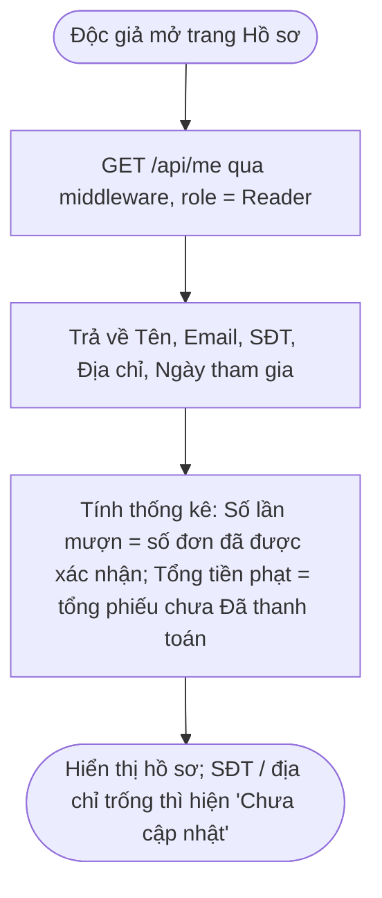
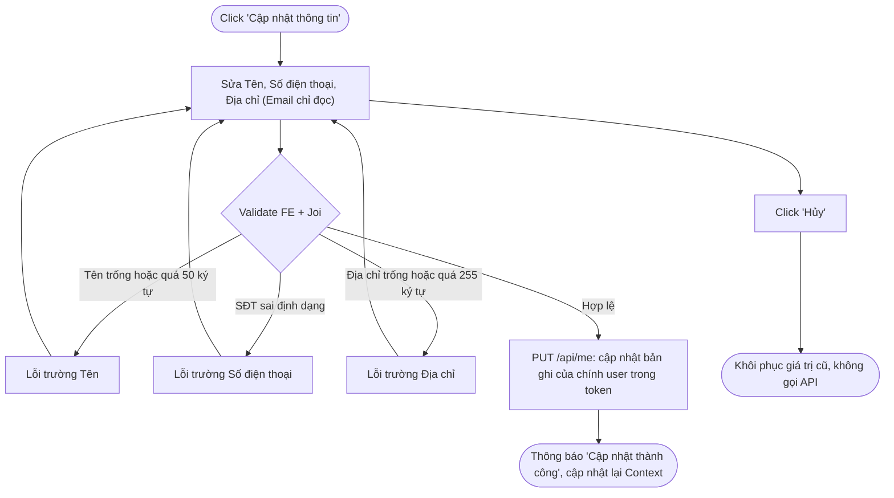
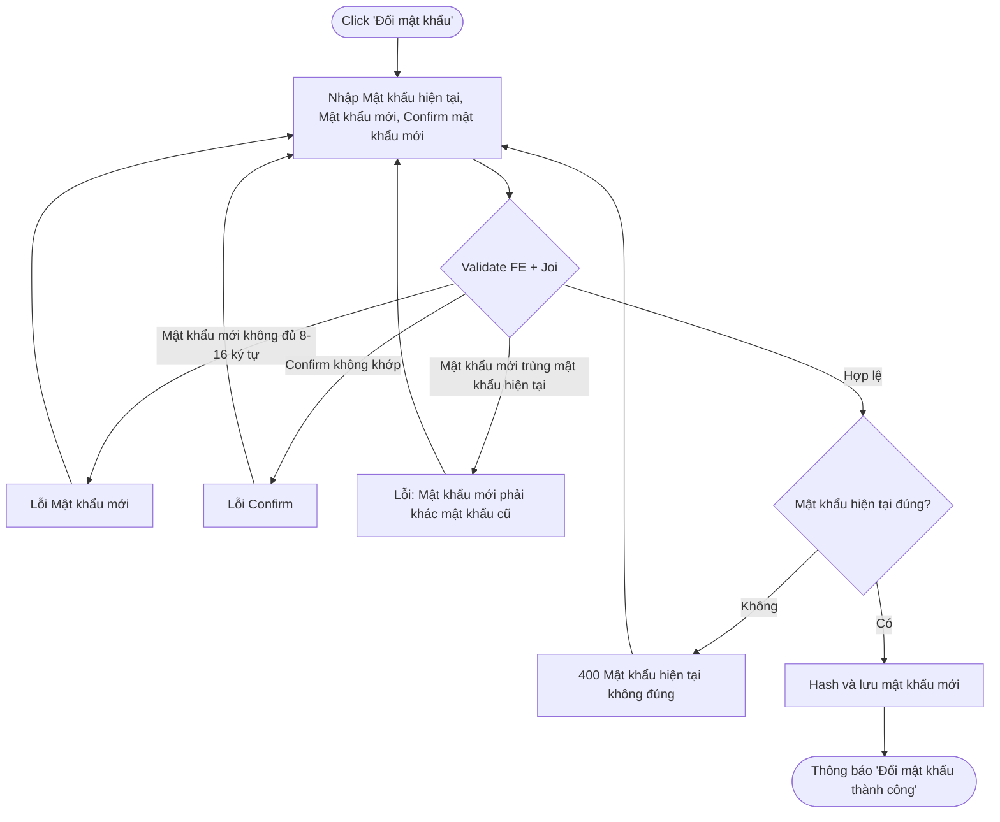

# 01 — Quản lý Tài Khoản (2.1)

## 2.1.1 Đăng Ký

**Actor:** Khách (chưa đăng nhập) · **API:** `POST /api/auth/register`

**Edge case:**
- Hai request đăng ký cùng email gần như đồng thời → unique constraint ở DB bắt request thứ hai → `409`.
- Người dùng không tự chọn được vai trò; mọi tài khoản mới là Reader (Admin đổi vai trò ở 2.6.2).

---

## 2.1.2 Đăng Nhập

**Actor:** Mọi người · **API:** `POST /api/auth/login`

**Edge case:**
- Sai email và sai mật khẩu trả **cùng một thông báo** để không lộ email nào đã đăng ký.
- Trạng thái tài khoản chỉ được báo sau khi mật khẩu đúng.
- Token hết hạn khi đang dùng → middleware trả `401` → FE đăng xuất và về trang đăng nhập (xem README).

---

## 2.1.3 Hồ Sơ Cá Nhân

**Actor:** Reader · **API:** `GET /api/me`, `PUT /api/me`, `PUT /api/me/password`

### Xem hồ sơ

### Cập nhật thông tin

### Đổi mật khẩu

**Edge case:** User chỉ sửa được hồ sơ của chính mình. API không nhận `userId` từ client mà lấy từ token.
