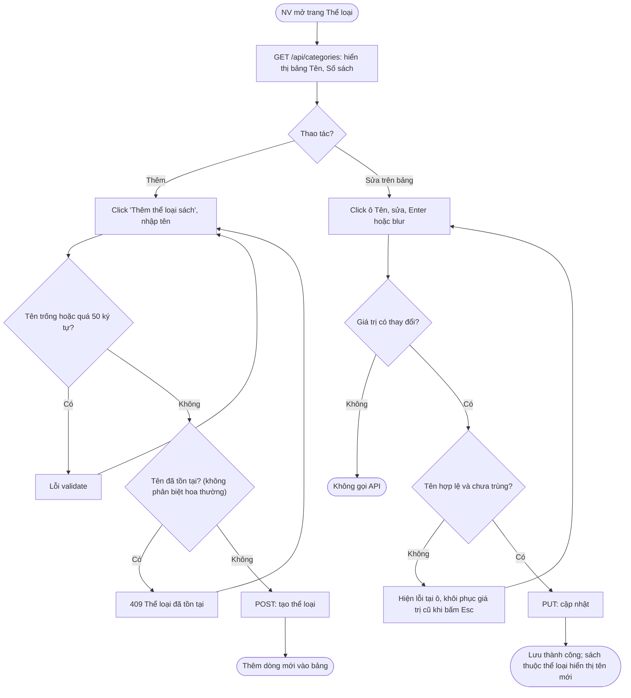
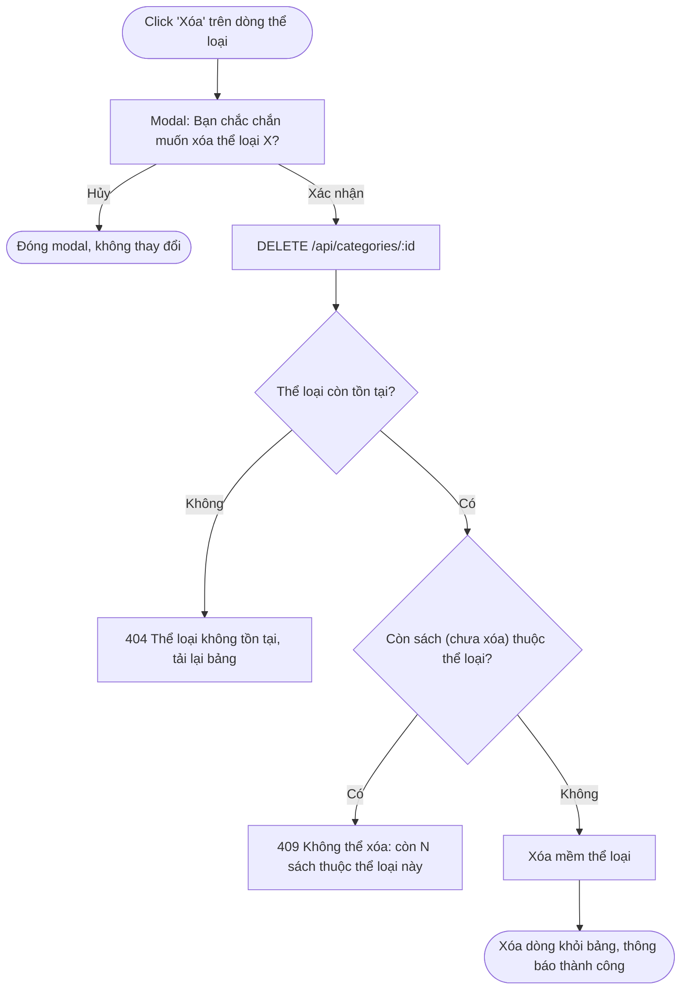
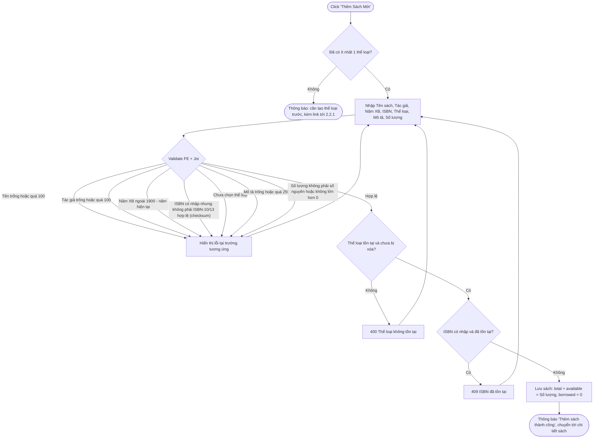
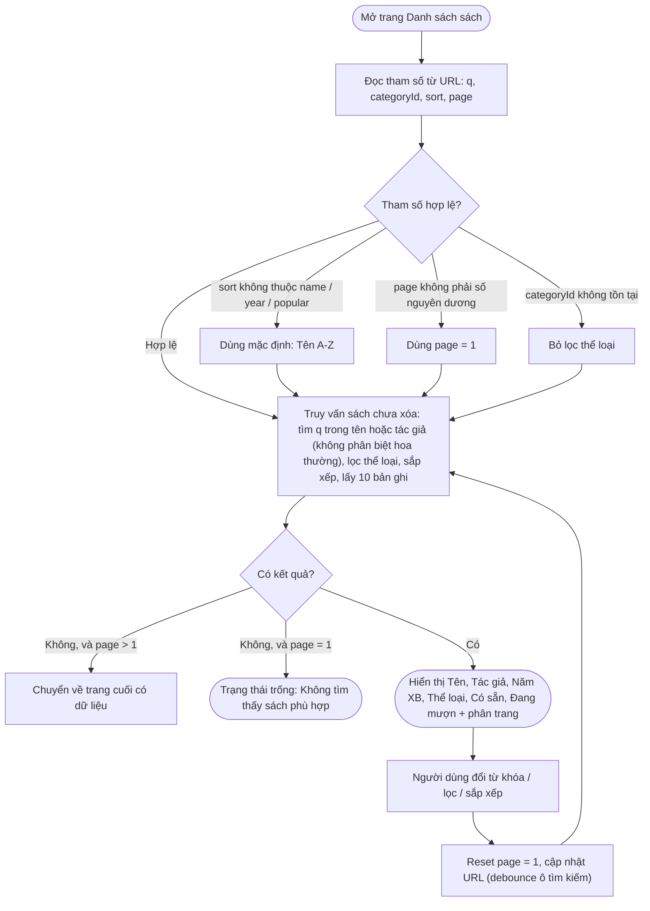
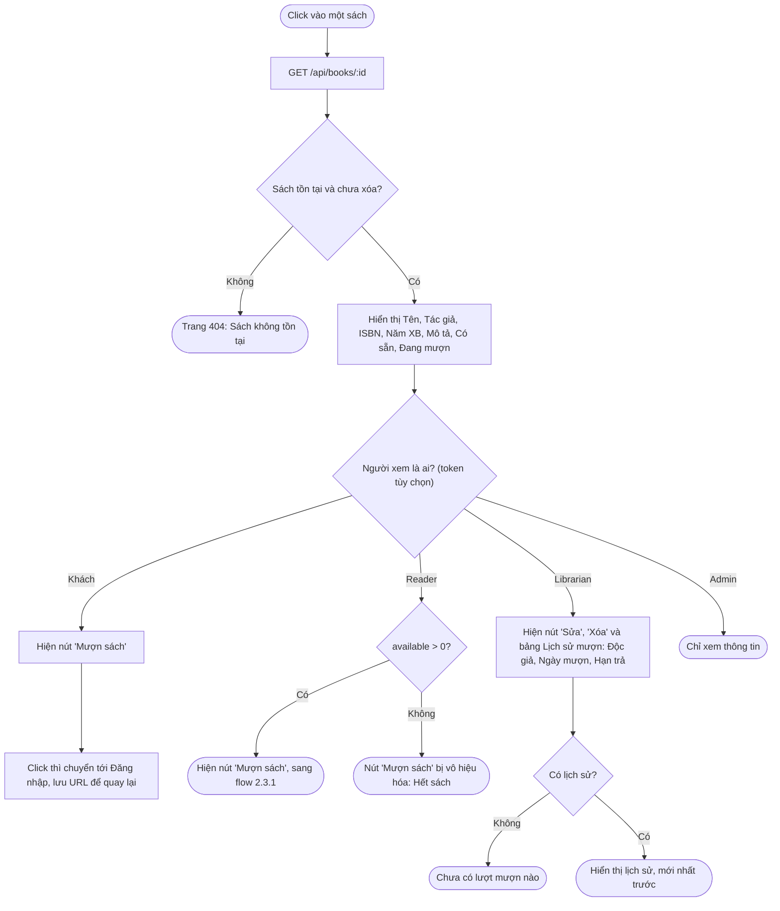
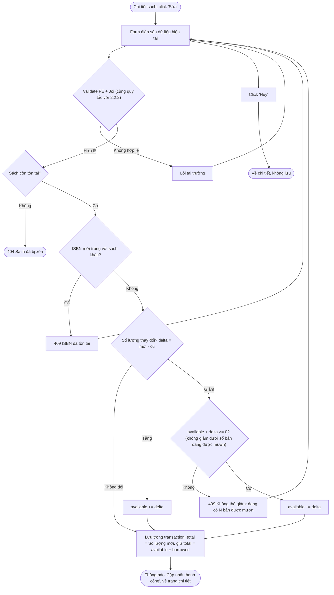
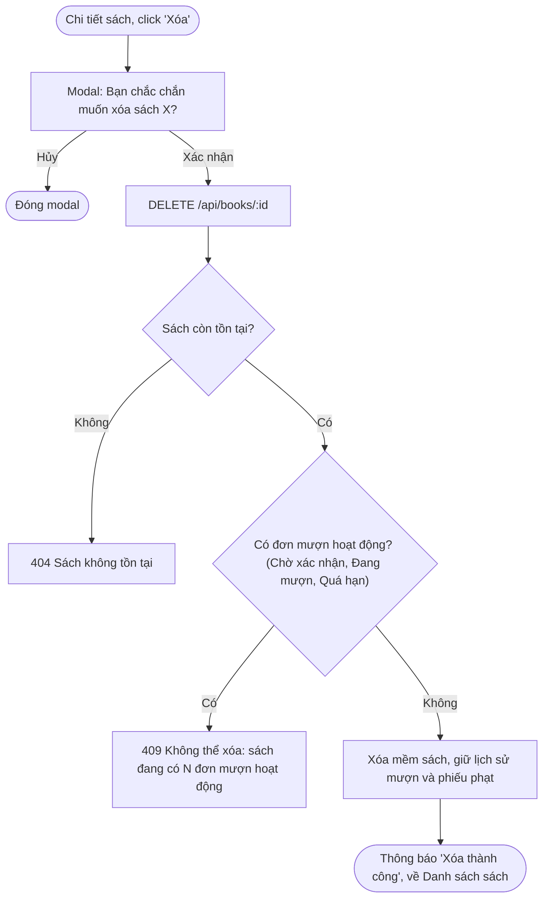

# 02 — Quản lý Sách (2.2)

## 2.2.1 Quản lý Thể Loại Sách

**Actor:** Librarian · **API:** `GET/POST /api/categories`, `PUT/DELETE /api/categories/:id`

### Xem, thêm, sửa trực tiếp trên bảng

### Xóa thể loại (deletion guard)

FE có thể ẩn hoặc vô hiệu hóa nút "Xóa" khi `Số sách > 0`, nhưng BE vẫn phải kiểm tra lại.

---

## 2.2.2 Thêm Sách Mới

**Actor:** Librarian · **API:** `POST /api/books`

ISBN được chuẩn hóa (bỏ dấu `-` và khoảng trắng) trước khi kiểm tra và lưu. Trạng thái "Có sẵn" / "Hết sách" được suy ra từ `available > 0`, không lưu riêng.

---

## 2.2.3 Xem Danh Sách Sách

**Actor:** Mọi người, không cần đăng nhập · **API:** `GET /api/books?q=&categoryId=&sort=&page=`

Sắp xếp: **Tên** A-Z · **Năm XB** mới nhất trước · **Phổ biến** = số đơn mượn đã được xác nhận, giảm dần.

---

## 2.2.4 Xem Chi Tiết Sách

**Actor:** Mọi người · **API:** `GET /api/books/:id` (+ `GET /api/books/:id/borrows` cho Librarian)

**Edge case:** Token không hợp lệ hoặc hết hạn trên API công khai → coi như Khách (không trả lỗi). API lịch sử mượn thì bắt buộc role Librarian, ngược lại trả `403`.

---

## 2.2.5 Sửa & Xóa Sách

**Actor:** Librarian · **API:** `PUT /api/books/:id`, `DELETE /api/books/:id`

### Sửa sách

### Xóa sách (deletion guard)

