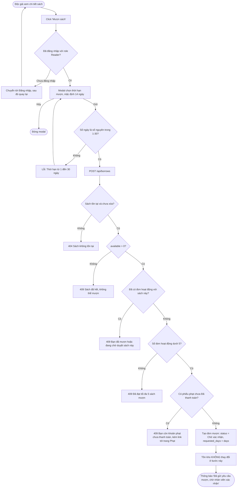
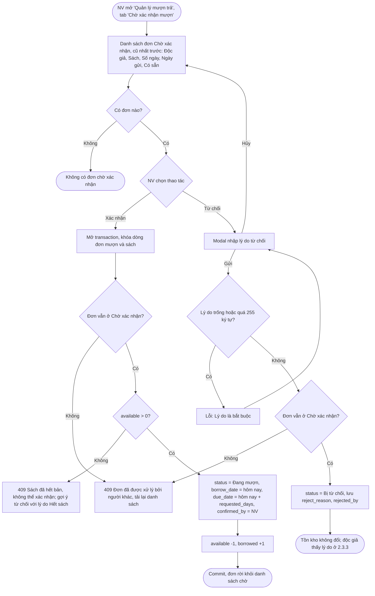
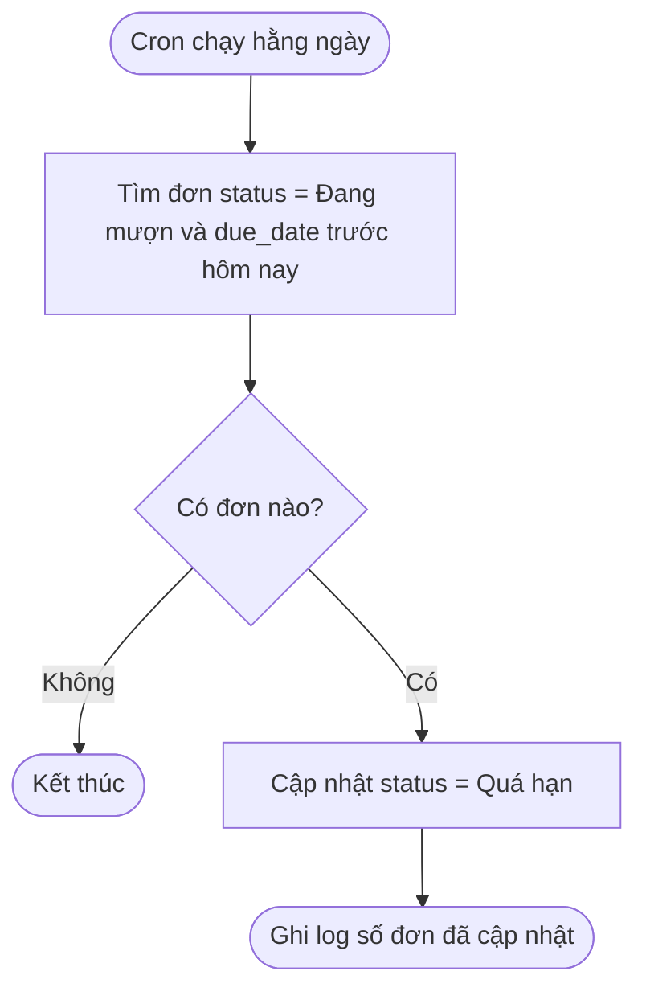
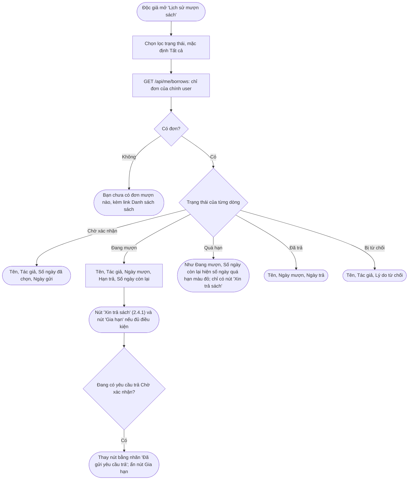
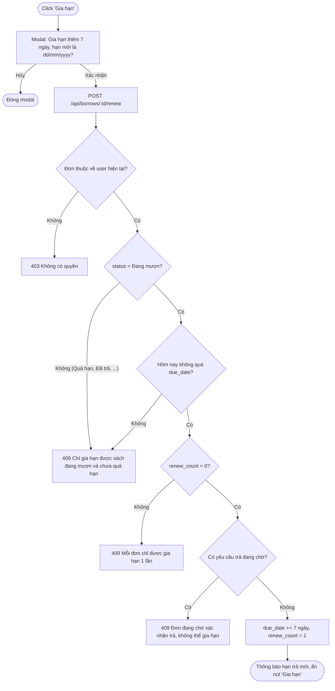

# 03 — Quản lý Mượn Sách (2.3)

## 2.3.1 Mượn Sách (Độc Giả)

**Actor:** Reader · **API:** `POST /api/borrows` body `{ bookId, days }`

**Ghi chú:**
- Đơn hoạt động = Chờ xác nhận + Đang mượn + Quá hạn (giả định A3).
- Các bước kiểm tra chạy theo thứ tự trên và trả về lỗi **đầu tiên** gặp phải. FE nên gọi trước `GET /api/borrows/eligibility?bookId=` để hiện lý do ngay trên nút "Mượn sách".
- Vì tồn kho chỉ giảm khi xác nhận, nhiều độc giả có thể cùng chờ cuốn sách cuối cùng. Việc này được xử lý ở 2.3.2.

---

## 2.3.2 Xác Nhận / Từ Chối Đơn Mượn (Nhân Viên)

**Actor:** Librarian · **API:** `GET /api/borrows?status=pending`, `POST /api/borrows/:id/confirm`, `POST /api/borrows/:id/reject`

**Edge case:**
- Tài khoản độc giả bị vô hiệu hóa trong lúc đơn đang chờ → NV vẫn xử lý được; nên từ chối với lý do tương ứng.
- Hai NV bấm xác nhận cùng lúc → chỉ một transaction thành công, người còn lại nhận `409`.

---

## Cập nhật Quá Hạn (job hệ thống)

**Actor:** Hệ thống, chạy hằng ngày lúc 00:05 (cron)

Nếu job chưa chạy, các màn hình vẫn hiển thị "Quá hạn" khi `due_date < hôm nay`, và phạt trả muộn ở 2.4.2 luôn tính theo ngày (giả định A8).

---

## 2.3.3 Xem Lịch Sử Mượn & Gia Hạn (Độc Giả)

**Actor:** Reader · **API:** `GET /api/me/borrows?status=`, `POST /api/borrows/:id/renew`

### Xem lịch sử

### Gia hạn

