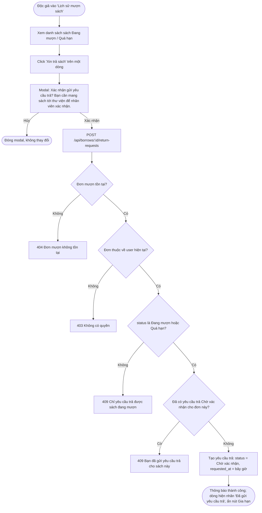
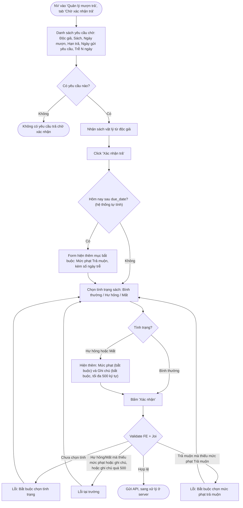
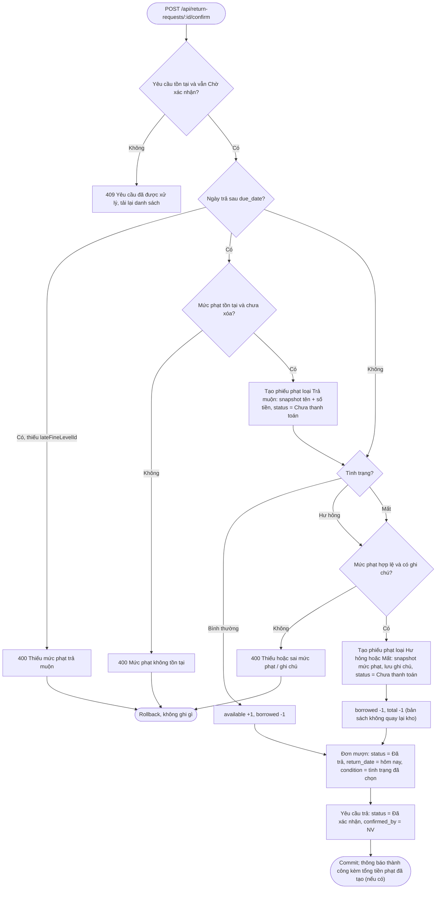

# 04 — Trả Sách (2.4)

## 2.4.1 Yêu Cầu Trả Sách

**Actor:** Reader · **API:** `POST /api/borrows/:id/return-requests`

**Edge case:** Unique partial index `(borrow_id) WHERE status = 'Chờ xác nhận'` ở DB đảm bảo chỉ có một yêu cầu chờ, kể cả khi độc giả bấm hai lần liên tiếp.

---

## 2.4.2 Xác Nhận Trả Sách

**Actor:** Librarian · **API:** `GET /api/return-requests?status=pending`, `POST /api/return-requests/:id/confirm`
body `{ condition, conditionFineLevelId?, note?, lateFineLevelId? }`

### Màn hình xác nhận

Nếu Admin chưa cấu hình mức phạt nào, dropdown sẽ trống và form hiện cảnh báo "Chưa có mức phạt, liên hệ quản lý viên (2.5.1)". Khi đó chỉ xác nhận được trường hợp Bình thường và không trễ hạn.

### Xử lý ở server (một transaction)

**Tổng hợp kết quả:**

| Tình trạng | Trễ hạn? | Phiếu phạt được tạo | Tồn kho | Đơn mượn |
|---|---|---|---|---|
| Bình thường | Không | — | available +1, borrowed −1 | Đã trả |
| Bình thường | Có | Trả muộn | available +1, borrowed −1 | Đã trả |
| Hư hỏng | Không | Hư hỏng | borrowed −1, total −1 | Đã trả |
| Hư hỏng | Có | Hư hỏng + Trả muộn | borrowed −1, total −1 | Đã trả |
| Mất | Không | Mất | borrowed −1, total −1 | Đã trả |
| Mất | Có | Mất + Trả muộn | borrowed −1, total −1 | Đã trả |

Sau khi có phiếu phạt, độc giả sẽ bị chặn mượn ở 2.3.1 cho tới khi mọi phiếu ở trạng thái "Đã thanh toán".
