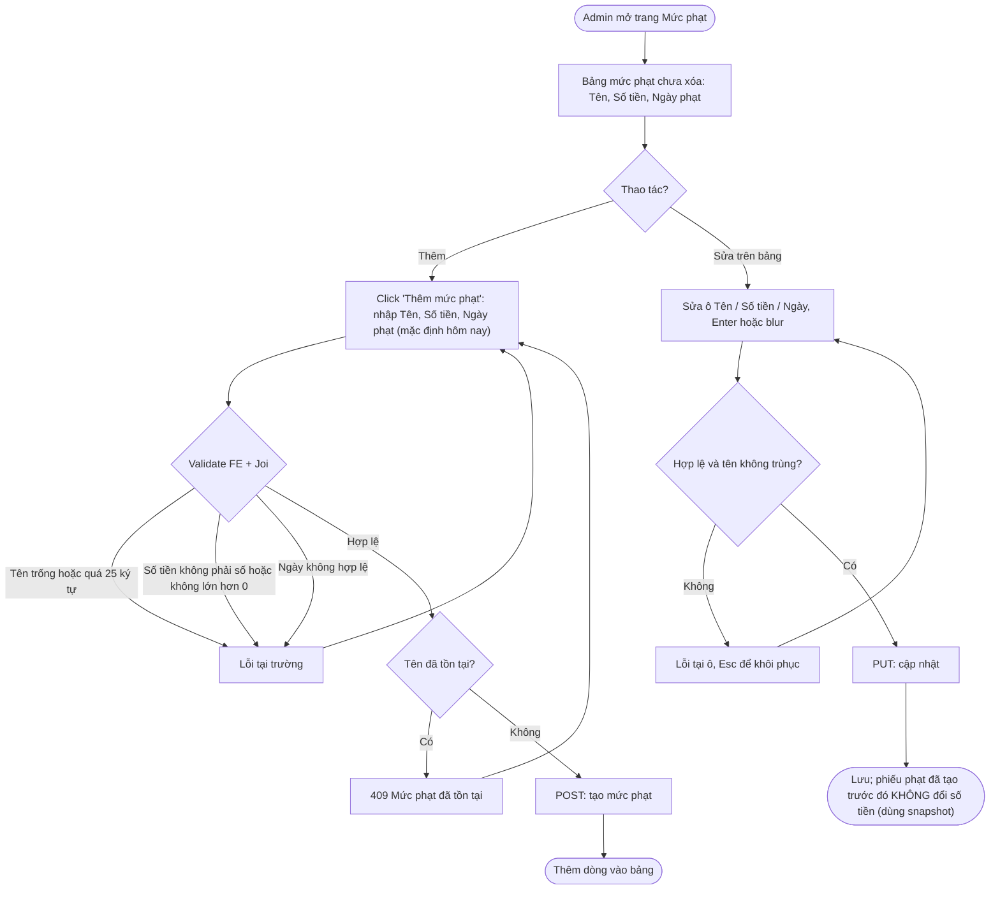
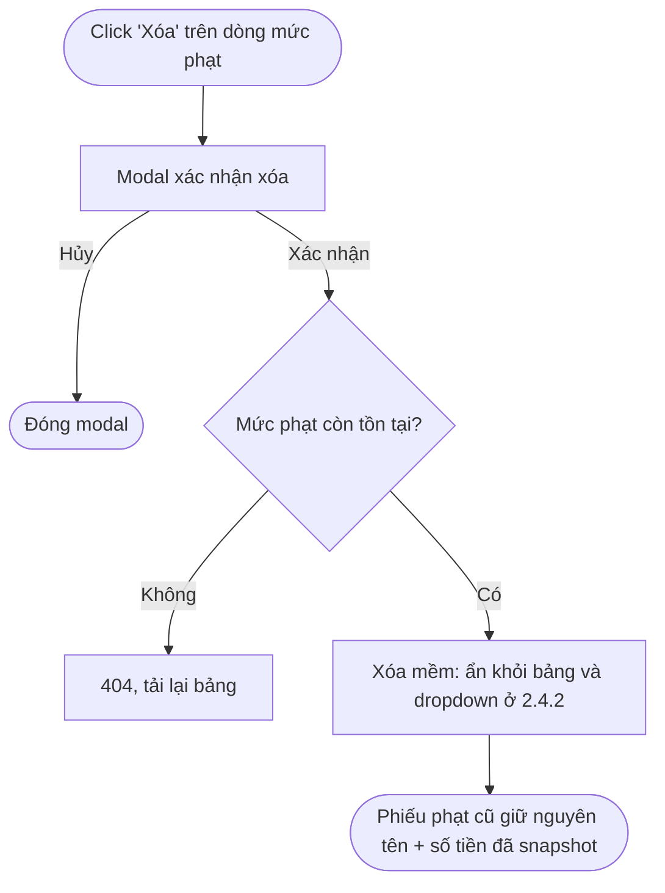
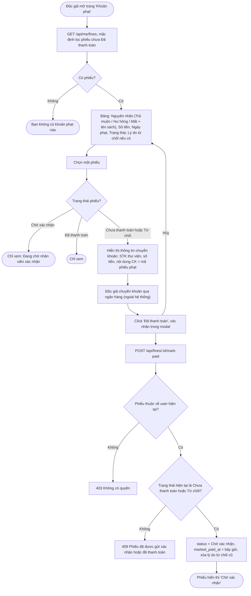
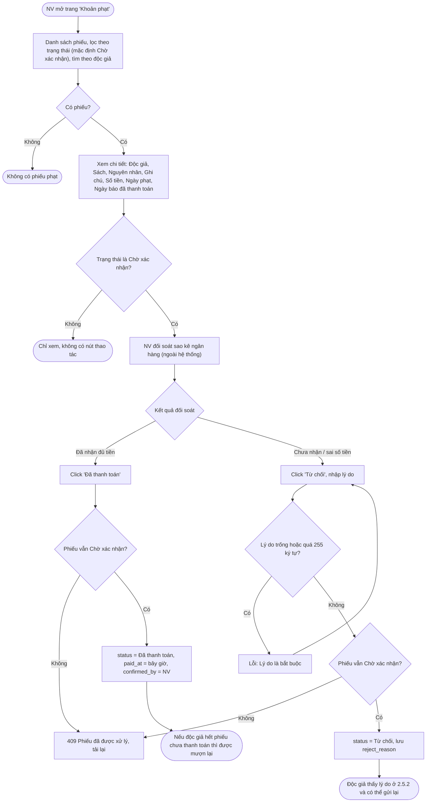

# 05 — Quản lý Nợ & Phạt (2.5)

## 2.5.1 Quản lý Mức Phạt

**Actor:** Admin · **API:** `GET/POST /api/fine-levels`, `PUT/DELETE /api/fine-levels/:id`

### Xem, thêm, sửa trực tiếp trên bảng

### Xóa mức phạt

---

## 2.5.2 Xem & Thanh Toán Khoản Phạt (Độc Giả)

**Actor:** Reader · **API:** `GET /api/me/fines?status=`, `POST /api/fines/:id/mark-paid`

Độc giả vẫn bị chặn mượn khi phiếu đang "Chờ xác nhận" hoặc "Từ chối" (giả định A4).

---

## 2.5.3 Xác Nhận Thanh Toán Phạt (Nhân Viên)

**Actor:** Librarian · **API:** `GET /api/fines?status=`, `GET /api/fines/:id`, `POST /api/fines/:id/confirm`, `POST /api/fines/:id/reject`

