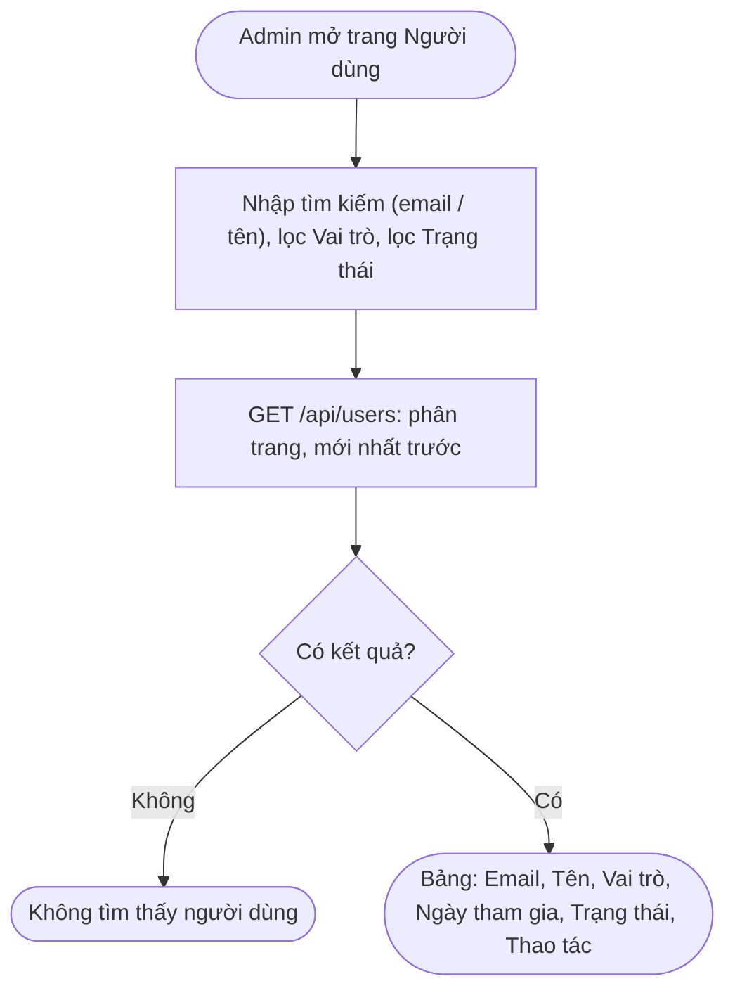
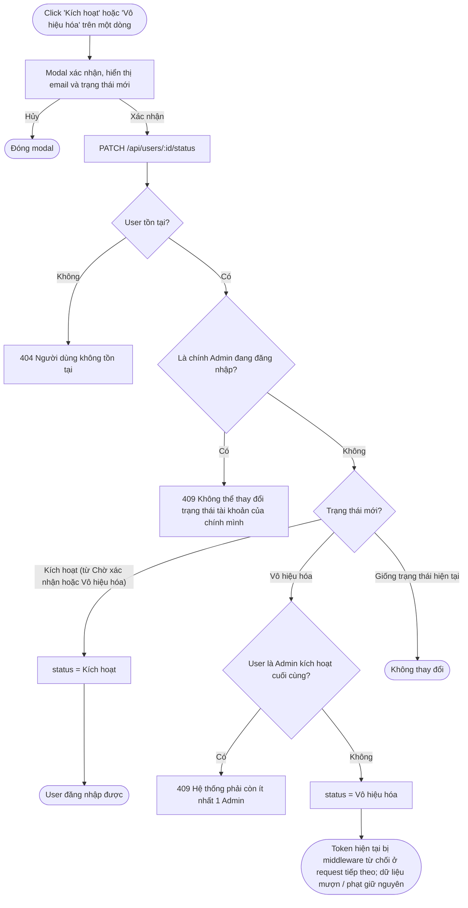
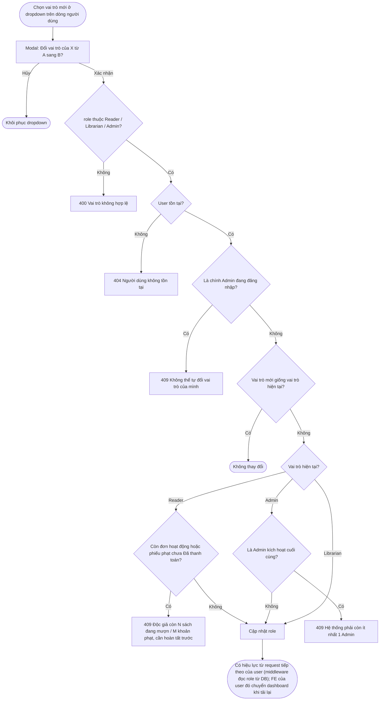

# 06 — Quản lý Người Dùng (2.6)

## 2.6.1 Danh Sách Người Dùng & Kích Hoạt / Vô Hiệu Hóa

**Actor:** Admin · **API:** `GET /api/users?q=&role=&status=&page=`, `PATCH /api/users/:id/status`

### Xem danh sách

Lọc "Chờ xác nhận" để Admin duyệt nhanh các tài khoản mới đăng ký (giả định A1).

### Đổi trạng thái tài khoản

**Edge case:** Độc giả bị vô hiệu hóa khi còn đang mượn sách → không đăng nhập được nhưng NV vẫn xử lý yêu cầu trả và phiếu phạt hiện có. Đơn "Chờ xác nhận" của họ nên được NV từ chối.

---

## 2.6.2 Gán Vai Trò

**Actor:** Admin · **API:** `PATCH /api/users/:id/role` body `{ role }`

**Quyền theo vai trò:**

| Vai trò | Quyền |
|---|---|
| Reader | Mượn / gia hạn / trả sách, xem lịch sử cá nhân, thanh toán phạt, sửa hồ sơ |
| Librarian | Quản lý thể loại & sách, xác nhận mượn / trả, xác nhận thanh toán phạt, xem báo cáo |
| Admin | Quản lý người dùng & vai trò, cấu hình mức phạt, xem báo cáo |
