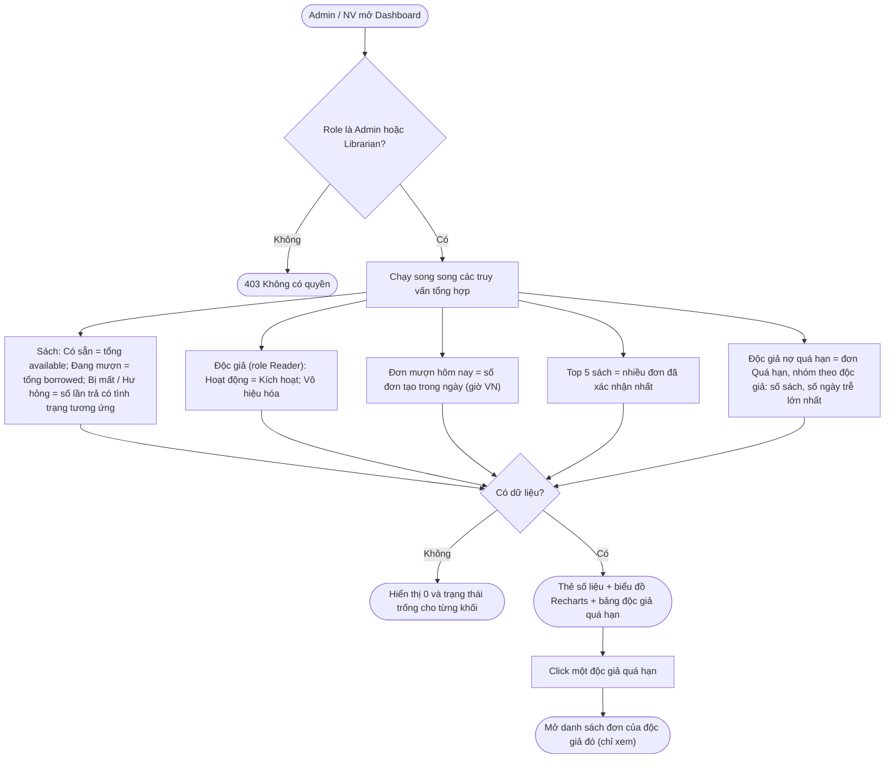
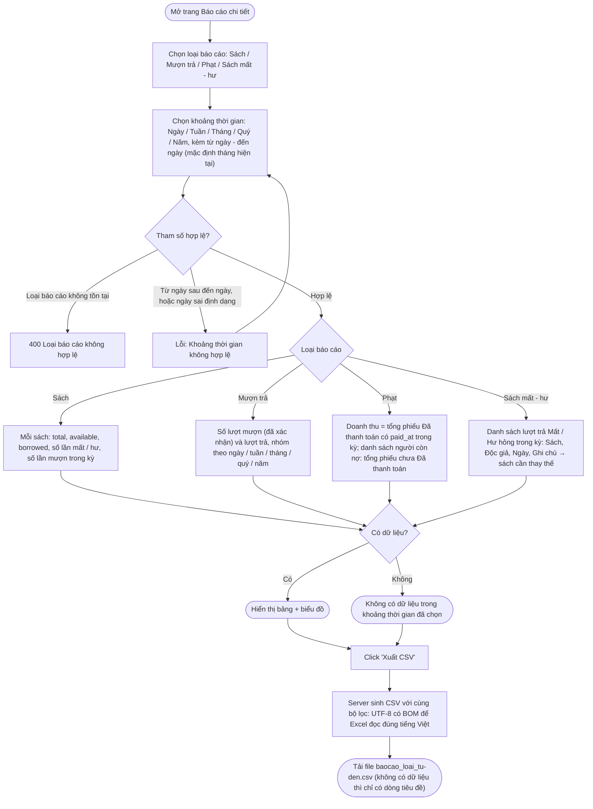

# 07 — Báo Cáo & Thống Kê (2.7)

## 2.7.1 Báo Cáo Tổng Quan (Dashboard)

**Actor:** Admin, Librarian · **API:** `GET /api/reports/overview`

**Edge case:** Một truy vấn lỗi thì khối đó hiện "Không tải được dữ liệu, thử lại"; các khối còn lại vẫn hiển thị.

---

## 2.7.2 Báo Cáo Chi Tiết

**Actor:** Admin, Librarian · **API:** `GET /api/reports/:type?period=&from=&to=` và `GET /api/reports/:type/export?...` (CSV)

**Edge case:**
- Khoảng thời gian quá dài với nhóm theo Ngày (vd. hơn 366 ngày) → yêu cầu chọn nhóm lớn hơn hoặc tự chuyển sang Tháng.
- Mọi mốc thời gian tính theo múi giờ `Asia/Ho_Chi_Minh` để "hôm nay" và "tháng này" khớp với thư viện.
