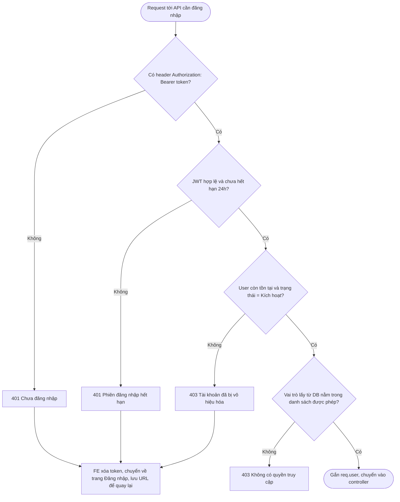
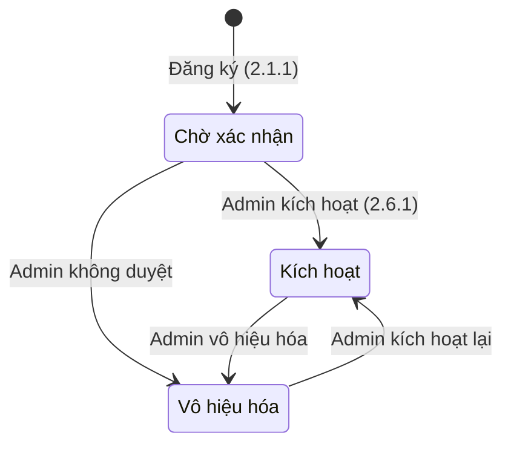
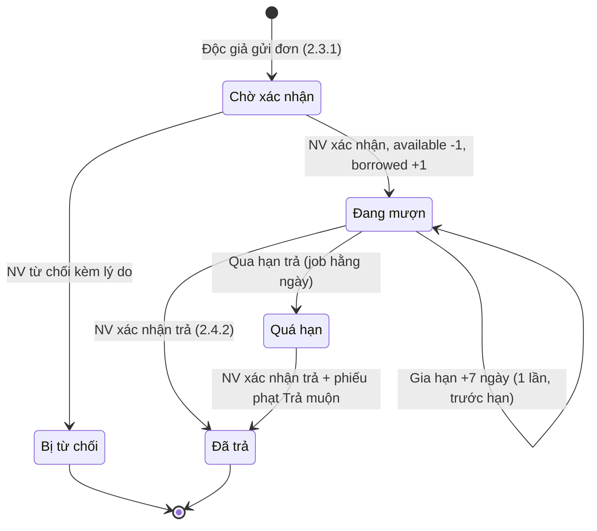
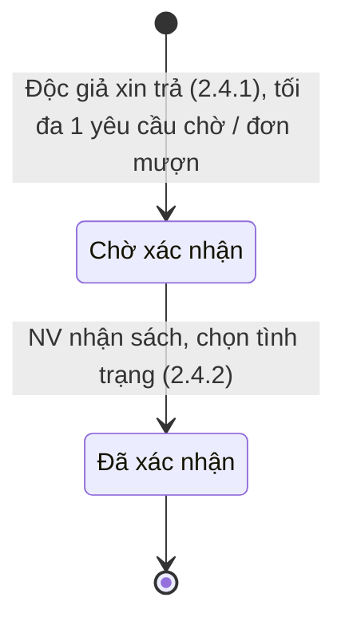
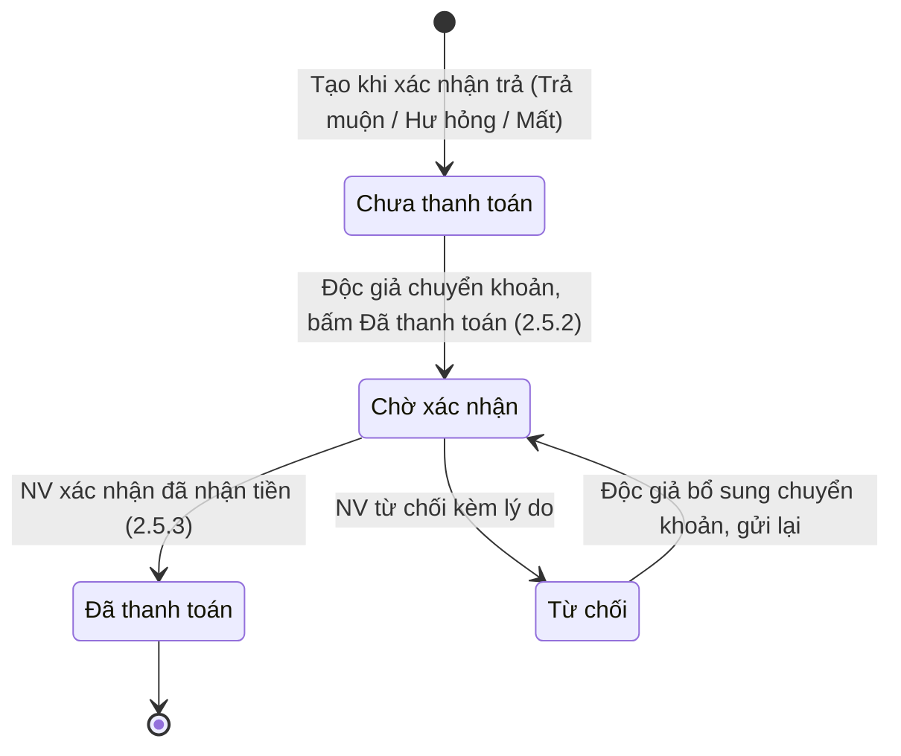

# Business Flows — Hệ Thống Quản Lý Thư Viện

Stage 2 (Design). Mỗi file mô tả flow nghiệp vụ của một module trong `.claude/PRD.md`, gồm **happy case** và **edge case**. Mã số `2.x.y` trỏ tới mục tương ứng trong PRD.

| File | Module | Tính năng |
|------|--------|-----------|
| [01-tai-khoan.md](01-tai-khoan.md) | Tài khoản | 2.1.1 Đăng ký · 2.1.2 Đăng nhập · 2.1.3 Hồ sơ cá nhân |
| [02-sach.md](02-sach.md) | Sách | 2.2.1 Thể loại · 2.2.2 Thêm sách · 2.2.3 Danh sách · 2.2.4 Chi tiết · 2.2.5 Sửa/Xóa |
| [03-muon-sach.md](03-muon-sach.md) | Mượn sách | 2.3.1 Độc giả mượn · 2.3.2 NV xác nhận/từ chối · 2.3.3 Lịch sử & gia hạn · Quá hạn |
| [04-tra-sach.md](04-tra-sach.md) | Trả sách | 2.4.1 Yêu cầu trả · 2.4.2 Xác nhận trả |
| [05-phat.md](05-phat.md) | Phạt | 2.5.1 Mức phạt · 2.5.2 Độc giả thanh toán · 2.5.3 NV xác nhận thanh toán |
| [06-nguoi-dung.md](06-nguoi-dung.md) | Người dùng | 2.6.1 Danh sách & kích hoạt/vô hiệu hóa · 2.6.2 Gán vai trò |
| [07-bao-cao.md](07-bao-cao.md) | Báo cáo | 2.7.1 Dashboard · 2.7.2 Báo cáo chi tiết |

## Quy ước chung

- **Validate hai lớp:** React Hook Form ở FE (chặn sớm, hiện lỗi dưới từng trường) → Joi ở BE (nguồn sự thật, trả `400` kèm danh sách lỗi theo trường). Các flow chỉ vẽ một nhánh "Không hợp lệ" cho cả hai lớp.
- **Mã lỗi:** `400` dữ liệu sai · `401` chưa đăng nhập / token hết hạn · `403` sai vai trò hoặc không phải chủ sở hữu · `404` không tồn tại · `409` vi phạm quy tắc nghiệp vụ hoặc trạng thái đã thay đổi.
- **Thao tác đổi trạng thái chạy trong một transaction** và kiểm tra lại trạng thái hiện tại bên trong transaction (tránh hai nhân viên cùng xử lý một đơn).
- **Tồn kho:** mỗi sách có `total` (số bản thư viện đang sở hữu), `available` (có sẵn), `borrowed` (đang mượn). Bất biến: `total = available + borrowed`.

## Middleware xác thực & phân quyền (dùng cho mọi API cần đăng nhập)

Vai trò và trạng thái được đọc từ DB ở mỗi request (không tin vào payload JWT), nên khi Admin đổi vai trò hoặc vô hiệu hóa tài khoản thì thay đổi có hiệu lực ngay.

## Vòng đời trạng thái

### Tài khoản

### Đơn mượn

### Yêu cầu trả sách

### Phiếu phạt

## Giả định thiết kế

PRD chưa nói rõ những điểm dưới đây nên flow tạm chọn như sau. Cần chốt trước khi làm ERD.

| # | Điểm chưa rõ | Giả định đang dùng |
|---|--------------|--------------------|
| A1 | Ai duyệt tài khoản "Chờ xác nhận"? | Admin kích hoạt ở 2.6.1. Tài khoản chưa kích hoạt không đăng nhập được. |
| A2 | 2.3.2 ghi "Đã mượn", 2.3.3 ghi "Đang mượn" | Dùng thống nhất **"Đang mượn"**. |
| A3 | "Đơn mượn hoạt động" gồm những gì? | Chờ xác nhận + Đang mượn + Quá hạn. Dùng cho giới hạn 5 cuốn và chặn xóa sách. |
| A4 | Thế nào là "phạt chưa thanh toán" khi kiểm tra điều kiện mượn? | Mọi phiếu chưa ở trạng thái "Đã thanh toán" (Chưa thanh toán, Chờ xác nhận, Từ chối). |
| A5 | Ngày mượn / hạn trả tính từ lúc nào? | Từ lúc NV **xác nhận** đơn: `due_date = ngày xác nhận + số ngày đã chọn`. |
| A6 | Một độc giả mượn 2 bản của cùng một sách? | Không cho: đã có đơn hoạt động với sách đó thì chặn. |
| A7 | Gia hạn có cần NV duyệt không? | Không, hệ thống tự gia hạn nếu đủ điều kiện. Không gia hạn khi đang có yêu cầu trả chờ xác nhận. |
| A8 | "Quá hạn" được cập nhật thế nào? | Job hằng ngày chuyển Đang mượn → Quá hạn. Phạt trả muộn tính theo ngày (`ngày trả > due_date`), không phụ thuộc job đã chạy hay chưa. |
| A9 | Trả muộn nhưng sách bình thường thì có phạt không? | Có, phiếu "Trả muộn" sinh ra với **mọi** tình trạng nếu trả muộn. NV chọn mức phạt từ danh sách. |
| A10 | Tồn kho khi sách hư hỏng / mất | `borrowed -1`, `total -1`, `available` giữ nguyên (bản đó không quay lại kho). Số mất / hư lấy từ bản ghi trả để báo cáo. |
| A11 | Xóa sách / thể loại / mức phạt đã có lịch sử | Xóa mềm (`deleted_at`) để giữ lịch sử mượn và phiếu phạt. Phiếu phạt lưu snapshot tên + số tiền của mức phạt. |
| A12 | ISBN, tên thể loại, tên mức phạt có được trùng không? | Không (ISBN unique nếu có; tên so sánh không phân biệt hoa thường). |
| A13 | Số điện thoại hợp lệ | Số Việt Nam: `^0\d{9}$`. |
| A14 | "Tổng số tiền phạt" ở hồ sơ | Tổng các phiếu **chưa** "Đã thanh toán". |
| A15 | Admin tự vô hiệu hóa / tự đổi vai trò của mình | Chặn, và hệ thống luôn còn ít nhất 1 Admin đang kích hoạt. |
| A16 | Đổi vai trò Reader khi còn nợ sách / phạt | Chặn cho tới khi không còn đơn hoạt động và phiếu phạt chưa thanh toán. |
| A17 | "Đơn mượn hôm nay" trên dashboard | Số đơn được **tạo** trong ngày (mọi trạng thái). |

## Câu hỏi mở (PRD chưa đề cập, flow chưa vẽ)

1. NV có được **từ chối yêu cầu trả** không (vd. độc giả không mang sách tới)? Hiện tại yêu cầu sẽ nằm ở "Chờ xác nhận" mãi.
2. Độc giả có được **hủy** đơn mượn hoặc yêu cầu trả đang chờ không?
3. Độc giả có cần **tải ảnh biên lai chuyển khoản** (Supabase Storage) khi bấm "Đã thanh toán" không?
4. NV có được xác nhận trực tiếp phiếu "Chưa thanh toán" khi độc giả trả tiền mặt tại quầy không?
5. Có cần email thông báo (duyệt tài khoản, xác nhận / từ chối đơn, sắp tới hạn) không?
